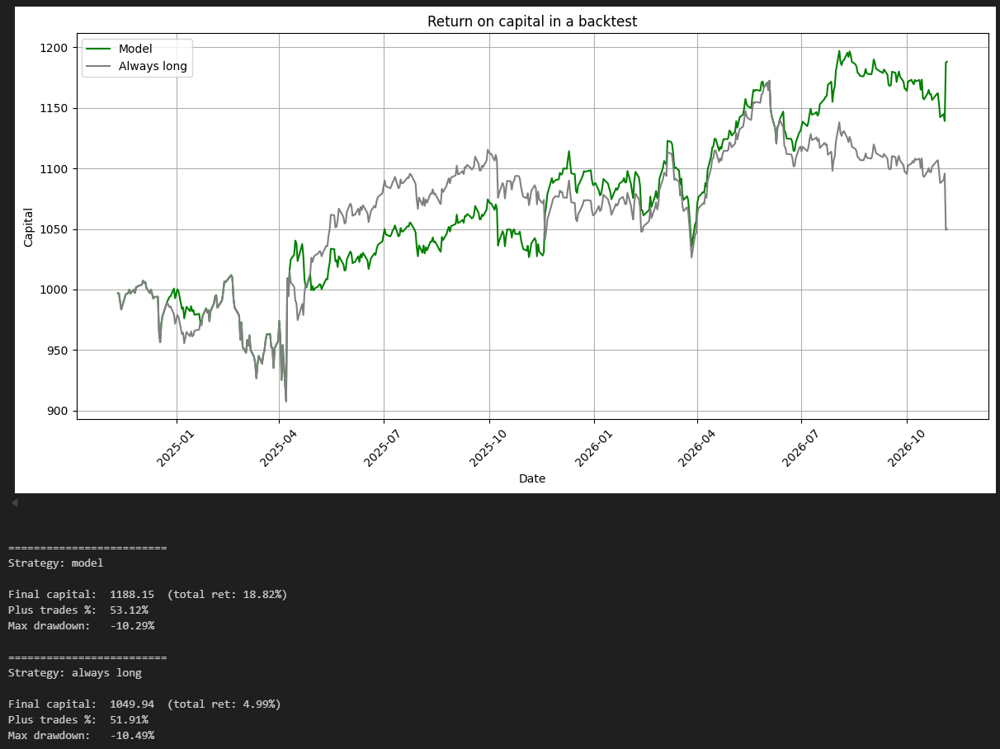

# 📈 Predicting the Next Day of SPY

A research project: can the direction of the next trading day be predicted from daily SPY quotes and the VIX index?

---

## 🎯 Goal

Build a predictive model that would support day trading by predicting the direction of the S&P 500 index on a given day, based on data up to the previous day. Specifically, we examine the **direction** of the candle: will the next day continue the direction of the previous one?

🖥️ Environment: Python 3.12.10

### ⚠️ Simplifications

The model does not account for:

- transaction costs,
- the opening gap (the position is opened at the day's open and closed at its close).

---

## 🛠️ Course of the Work

### 🎯 Defining the target

In the first attempts, the direction of the next day was predicted directly. Switching from predicting up and down moves to predicting continuation or reversal of the move improved the results.

### ⏱️ Interval

Initially, the hourly interval was considered. Shorter intervals mean more noise and make it harder to build a model that can extract anything from such data, so the project was ultimately based on the daily interval.

### 🔁 Walk-forward

In an earlier version, the model was trained and tested on data from the last 20 years. Then, for comparison, the entire process of training, validation and backtesting was run in a loop 8 times on 12-year time windows (from 2007-2019 to 2014-2026).

### 🤖 Model selection

| # | Model | Outcome |
|---|-------|---------|
| 1 | 🧠 **CNN + LSTM** | Too little data for a neural network to gain an edge. |
| 2 | 🌳 **LightGBM** | Decision trees tended to overfit. Training, validation and test results diverged significantly, so a simpler model was tried. |
| 3 | ✅ **Logistic regression** | The final model: logistic regression with feature selection and regularization strength chosen on a separate validation set. It is evaluated chronologically (training, validation, backtest on the last two years) and always compared with a constant prediction and an "always long" strategy. |

---

## 🔍 Observations and Conclusions

- 📅 A shorter data period improved the results. The model may have been learning patterns from 20 years ago that no longer apply to the current market.
- 🔄 Training in a loop with a window shifted every 1 year did not produce repeatable results. Each time, however, the model showed a positive jump at moments of high volatility.
- ⚡ In the backtest, the model gave its biggest edge during market crashes (April 2025, October 2026).

🏁 **Conclusion**

The model does not give a stable edge over the "always long" strategy, although in windows containing a market crash and rebound (e.g. April 2025, October 2026) the model was more effective than "always long".
The edge is therefore slight and period-dependent, too small for ML to replace a classical decision-making process based on technical and fundamental analysis.

---

## 📊 Result

